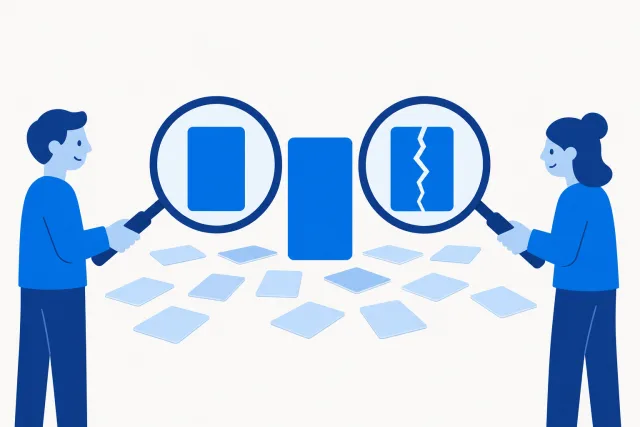

# Jadlis — плагины для Claude Code

<p align="center">
  
</p>

Каталог плагинов `jadlis` для Claude Code. Сейчас в нём девятнадцать плагинов: рабочее место в терминале, голосовой ввод, ресёрч, проверка
планов, браузер, почта, задачи, секреты и регистрация на сервисах, новости, книги, гид по методу нейроинтеграции и инструменты, чтобы собирать своих ИИ-сотрудников.

| Плагин | Команда | Что даёт |
|---|---|---|
| [`jadlis-claudecode`](https://github.com/becyb-org/jadlis-claudecode) | `/claudecode` | Claude Code, терминал и папка `~/Jadlis` как у автора: настройки, хуки, команды `cld` и `tld`, переход в bypass после плана с телефона. По желанию ставит [глобальный CLAUDE.md](https://github.com/becyb-org/jadlis-claude-md) и [стили ответа](https://github.com/becyb-org/jadlis-output-styles). |
| [`jadlis-notifications`](https://gitlab.com/beCyborg/jadlis-notifications) | — | Уведомления macOS, когда Claude Code закончил или ждёт ответа. Ставится отдельно: `/claudecode` предлагает его. |
| [`jadlis-voice`](https://gitlab.com/beCyborg/jadlis-voice) | `/jadlis-voice` | Диктуешь вслух — в поле встаёт чистый текст без «э-э-э». Скопированный текст читается вслух по одной клавише. |
| [`jadlis-search`](https://gitlab.com/beCyborg/jadlis-search) | `/search` | ИИ ищет в интернете и читает страницы. Здесь же хранятся ключи. Это база для обоих ресёрчей. |
| [`jadlis-research`](https://gitlab.com/beCyborg/jadlis-research) | `/research` | Один вопрос — отчёт из 14 каналов. Ключевые утверждения перепроверены, непроверенные помечены. |
| [`jadlis-science-research`](https://gitlab.com/beCyborg/jadlis-science-research) | `/science-research` | Что реально доказано наукой: научные базы, проверка на отзыв статьи, вывод по силе доказательства. |
| [`jadlis-verif`](https://gitlab.com/beCyborg/jadlis-verif) | `/verif` | Две модели разных компаний ищут дыры в твоём плане порознь, арбитр сводит находки в один список. |
| [`jadlis-browser`](https://gitlab.com/beCyborg/jadlis-browser) | `/browser` | ИИ работает в браузере на сайтах, где ты уже залогинен: в своём профиле Chrome в фоне или в твоём Chrome через мост. Пароли не передаются. |
| [`jadlis-computer-use`](https://gitlab.com/beCyborg/jadlis-computer-use) | `/computer-use` | ИИ работает в приложениях Mac: меньше скриншотов, надёжные клики и ввод. |
| [`jadlis-mail`](https://gitlab.com/beCyborg/jadlis-mail) | `/mail` | ИИ читает твою почту: что важного, поиск писем и вложений, разбор входящих с откатом. Письмо уходит только после твоего «да». |
| [`jadlis-ticktick`](https://gitlab.com/beCyborg/jadlis-ticktick) | `/ticktick` | Задачи, привычки и фокус в TickTick короткими фразами: «что на сегодня», «добавь …», «заверши …». |
| [`jadlis-secrets`](https://gitlab.com/beCyborg/jadlis-secrets) | `/secrets` | Логины и ключи агента в одном хранилище 1Password, без Touch ID. Пароль не попадает в переписку с ИИ. |
| [`jadlis-signup`](https://gitlab.com/beCyborg/jadlis-signup) | `/signup` | ИИ регистрируется на сервисе за тебя: отдельный адрес-алиас, пароль в 1Password, письмо подтверждения. Оплата и телефон — за тобой. |
| [`jadlis-swot-news`](https://gitlab.com/beCyborg/jadlis-swot-news) | `/swot-news` | Новости дня как SWOT для тебя: что из происходящего в мире помогает, а что мешает твоим планам. |
| [`jadlis-tldr`](https://gitlab.com/beCyborg/jadlis-tldr) | `/tldr` | Выжимка из видео YouTube или текстового файла: суть, главные идеи, что делать. |
| [`jadlis-books`](https://gitlab.com/beCyborg/jadlis-books) | `/books` | Найти и скачать книгу или статью по DOI через Архив Анны. Нужно своё членство. |
| [`jadlis-skill-builder`](https://gitlab.com/beCyborg/jadlis-skill-builder) | `/skill-builder` | Свой ИИ-сотрудник: пишешь инструкцию, как для нового работника, и ИИ делает эту работу сам. |
| [`jadlis-plugin-builder`](https://gitlab.com/beCyborg/jadlis-plugin-builder) | `/plugin-builder` | Собрать, проверить и выпустить свой плагин, чтобы отдать его другому человеку. |
| [`jadlis-nif`](https://gitlab.com/beCyborg/jadlis-nif) | `/nif` | Метод нейроинтеграции под рукой: что делать сегодня, что делать, когда накрыло, и почему. Неофициальный пересказ своими словами. |

> [!IMPORTANT]
> Нужен Mac и подписка [Claude](https://claude.ai) на тарифе Max.
> Для поиска и ресёрча нужны два ключа: [Brave Search](https://brave.com/search/api/) и [Firecrawl](https://firecrawl.dev).
> Для `jadlis-voice` нужны ключи [ElevenLabs](https://elevenlabs.io) и [Anthropic API](https://console.anthropic.com): это отдельный счёт, подписка Claude сюда не подходит.
> Для `jadlis-verif` нужна своя подписка [ChatGPT](https://chatgpt.com): он работает через Codex CLI.
> Для `jadlis-browser` нужен Chrome и расширение-мост из Chrome Web Store, подробности в README плагина.
> Для `jadlis-mail` нужен himalaya, для `jadlis-secrets` — 1Password с сервисным аккаунтом, для `jadlis-signup` — ещё и Proton Pass.
> `jadlis-signup` сам ставит `jadlis-secrets`, `jadlis-mail` и `jadlis-browser`. Скрипты и шаблон агента из них копируются по шагу «Установка» в README каждого плагина.

## Установка

Рабочее место — первым, остальные плагины исходят из того, что оно собрано:

```
claude plugin marketplace add https://gitlab.com/beCyborg/jadlis-hub.git
claude plugin install jadlis-claudecode@jadlis
```

Потом набери `/claudecode` в чате Claude Code. Скилл спрашивает перед каждой установкой и перезаписью.

Ресёрч — скопируй в терминал по очереди:

```
claude plugin marketplace add https://gitlab.com/beCyborg/jadlis-hub.git
claude plugin install jadlis-search@jadlis
claude plugin install jadlis-research@jadlis
claude plugin install jadlis-science-research@jadlis
```

Первая команда ничего не ставит, она добавляет каталог. Ссылку пиши целиком, с `https://` и `.git`:
короткая запись `владелец/репозиторий` в Claude Code работает только для GitHub.

`jadlis-search` ставь первым. Потом введи ключи в чате Claude Code командой `/plugin configure jadlis-search@jadlis`.
Поля с ключами при вводе скрыты, значения уходят в Связку ключей macOS.

Остальные плагины ставятся по одному. Друг от друга зависит только `jadlis-signup`:

```
claude plugin install jadlis-voice@jadlis
claude plugin install jadlis-verif@jadlis
claude plugin install jadlis-browser@jadlis
claude plugin install jadlis-skill-builder@jadlis
claude plugin install jadlis-plugin-builder@jadlis
claude plugin install jadlis-nif@jadlis
claude plugin install jadlis-computer-use@jadlis
claude plugin install jadlis-mail@jadlis
claude plugin install jadlis-ticktick@jadlis
claude plugin install jadlis-secrets@jadlis
claude plugin install jadlis-signup@jadlis
claude plugin install jadlis-swot-news@jadlis
claude plugin install jadlis-tldr@jadlis
claude plugin install jadlis-books@jadlis
```

Подробности по каждому плагину, текст для вставки агенту и первый запуск — в README плагина по ссылке из таблицы.

## Обновление

У стороннего каталога автообновление по умолчанию выключено. Обновиться можно так:

```
claude plugin marketplace update jadlis
claude plugin update <плагин>@jadlis
```

Например, `claude plugin update jadlis-research@jadlis`. Повтори для каждого плагина, который у тебя стоит.

Чтобы обновления приходили сами, включи автообновление для `jadlis`: `/plugin` → Marketplaces → `jadlis`.

## Если каталог уже стоял со ссылки GitHub

Раньше каталог жил на `github.com/beCyborg/jadlis-hub`. Сейчас этот аккаунт заблокирован, и старая ссылка открывает 404.
Удали каталог командой `claude plugin marketplace remove jadlis` и поставь всё заново по разделу «Установка».
Плагины этого каталога при удалении тоже снимутся, поэтому ключи для `jadlis-search` придётся ввести ещё раз.

<details>
<summary>Условия использования, ошибки и правки</summary>

**Условия использования.** Лицензии нет: все права сохранены за автором. Читать и
пользоваться лично можно. Коммерческое использование, переиздание и включение в свои
продукты — по договорённости со мной.

**Если не встало** — напиши в issue этого репозитория. Для этого нужен аккаунт GitLab.

**Как предложить правку** — [CONTRIBUTING.md](CONTRIBUTING.md).

</details>
